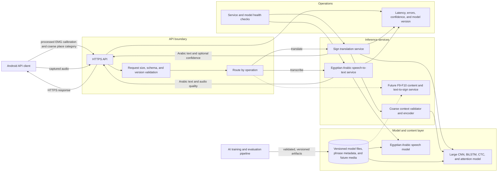
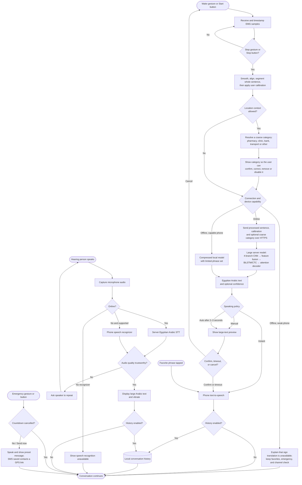

# Sout (صوت) Architecture and Data Flow

These diagrams are derived from the requirements and the eight screens in the HTML prototype. They intentionally use only two views:

1. A static component view shows the app architecture and its communication boundaries.
2. A backend view expands the server runtime, model artifacts, and operational boundaries.
3. A runtime data-flow view shows how user and sensor data move through the program.

This avoids repeating the same structure as separate app, backend, deployment, and communication diagrams.

## 1. App architecture and component communication

The solid components cover F1–F8. The future content path covers F9–F10 and is kept outside the first-release runtime.

```mermaid
graph LR
    Band[sEMG & 6-Axis IMU Armband]
    Hearing[Hearing person]
    Contacts[Emergency contacts]

    subgraph Phone
        Screens[App screens and mode banner]
        Controllers[Application controllers]
        BLE[Bluetooth adapter]
        Signal[Multi-modal sensor fusion & preprocessing<br/>(8-ch sEMG + 6-axis IMU kinematics)]
        Context[Coarse place context resolver]
        Mode[Connection and capability selector]
        LocalModel[On-device translation model]
        LocalSTT[Phone speech recognizer]
        LocalStore[(Protected local store)]
        PhoneIO[Phone services]
        ApiClient[HTTPS API client]
        ModelUpdater[Model and content downloader]

        Screens --> Controllers
        Controllers --> BLE
        BLE --> Signal
        Controllers --> Signal
        Controllers --> Context
        Signal --> Mode
        Context --> LocalModel
        Context --> ApiClient
        Mode -->|offline capable| LocalModel
        Mode -->|online| ApiClient
        Controllers --> LocalSTT
        LocalSTT --> Controllers
        LocalModel --> Controllers
        ApiClient --> Controllers
        Controllers --> PhoneIO
        Controllers --> LocalStore
        LocalStore --> Controllers
        ModelUpdater --> LocalModel
    end

    Backend[Backend APIs and artifact hosting]

    Band -->|EMG and device status| BLE
    BLE -->|connection state| Band
    Hearing -->|audio| PhoneIO
    PhoneIO -->|microphone stream| Controllers
    PhoneIO -->|permissioned location| Context
    PhoneIO -->|SMS and location link| Contacts

    ApiClient -->|processed signal audio or coarse context| Backend
    Backend -->|Arabic text and confidence| ApiClient
    ModelUpdater -->|artifact request| Backend
    Backend -->|versioned artifacts| ModelUpdater
```

Communication contracts that must be fixed across teams:

- BLE contract: sample rate, eight-channel order, scaling, timestamps, battery/contact fields, and whether IMU data exists.
- Translation API: processed whole-sentence signal, calibration values and an optional coarse place category in; Egyptian Arabic text and optional confidence out. Precise coordinates are excluded.
- Speech API: captured audio in; Egyptian Arabic text plus an audio-quality/confidence indication out.
- Artifact contract: version, checksum, supported phrase list, minimum device capability, and rollback metadata.
- Privacy boundary: history and favorites stay local; raw EMG/audio are encrypted in transit and are not retained by default.

## 2. Backend architecture

The backend is stateless for normal inference. It loads versioned AI artifacts, returns inference results, and records operational metadata rather than conversation content.



Backend responsibilities and boundaries:

- Translation and speech recognition are separate services so they can scale and change models independently.
- The mobile app and backend use the same signal format, channel order, scaling, and preprocessing contract.
- The translation service accepts only an allow-listed coarse place category. Precise coordinates and background location history never enter the inference API.
- Model artifacts are immutable and versioned; every result can be associated with the model version that produced it.
- Telemetry contains latency, errors, confidence, and model versions. Raw EMG, audio, and translated conversations are not persisted without explicit consent.
- F9 dictionary hosting and F10 text-to-sign remain future extensions and are shown with dotted connections.

## 3. Runtime data flow

This view follows data transformations and decisions. It includes the main sign-to-speech path, the return speech-to-text path, and the two safety-net paths that deliberately bypass AI.



### Scope notes

- The current HTML prototype maps to F1–F8; F9 dictionary/learning and F10 text-to-sign have no prototype screens yet.
- Calibration and preprocessing stay on the phone and work offline.
- Location context is opt-in and reduced on the phone to a visible coarse category. Precise coordinates stay local except when the user triggers the emergency SMS flow.
- The user can correct, remove or disable context, and the model must not let it override strong EMG evidence.
- The server receives a completed sentence, matching the current whole-sentence requirement. Streaming inference remains an open design decision.
- Emergency, favorite phrases, history, and the calibration channel check do not depend on the backend.
- Emergency services are not called automatically in the current scope; only saved contacts receive SMS.
